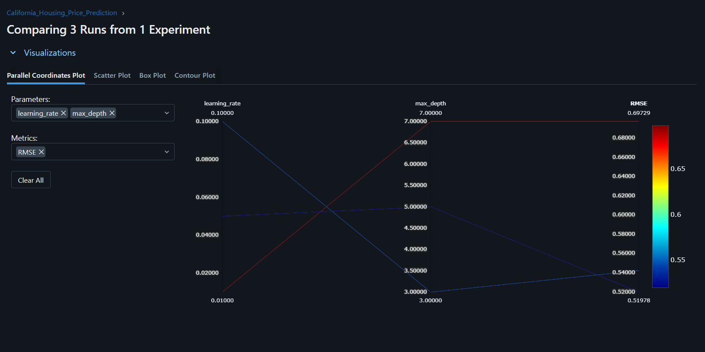

# ML Experiment Tracking with MLflow — California Housing Price Prediction

## 1. Task Description
This project describe machine learning experiment tracking using **MLflow**. We train a `GradientBoostingRegressor` model on the **California Housing dataset** split into 80% training and 20% validation sets across three different hyperparameter (`max_depth` and `learning_rate`). For each run, MLflow tracks the hyperparameters, validation metrics (`RMSE`, `MAE`, and `R2`), and saves the trained model artifact to identify the best-performing configuration.

## 2. How to Run the Project

1. **Clone the repository and navigate to the project folder:**

2. **Create and activate a virtual environment:**

3. **Install dependencies:**
   ```powershell
   pip install -r requirements.txt
   ```

4. **Run the training and logging script:**

5. **Launch the MLflow UI to view and compare results:**


## 3. MLflow Experiment Results Screenshot


## 4. Comparison Table of the Three Runs

| Run | Max Depth | Learning Rate | RMSE | MAE | $R^2$ |
| :--- | :---: | :---: | :---: | :---: | :---: |
| **Run 1** | 3 | 0.1 | 0.542 | 0.372 | 0.776 |
| **Run 2** | **5** | **0.05** | **0.520** | **0.353** | **0.794** |
| **Run 3** | 7 | 0.01 | 0.697 | 0.531 | 0.629 |

## 5. Selected Best Model
**Run 2** is selected as the best model.

## 6. Why Run 2 Was Selected
Using **RMSE** as the primary evaluation metric, **Run 2** achieved the lowest Root Mean Squared Error. Additionally, Run 2 achieved the lowest Mean Absolute Error and the highest $R^2$ score.
A `max_depth` of 5 allowed the model to capture more complex feature interactions than depth 3.